<div align="center">

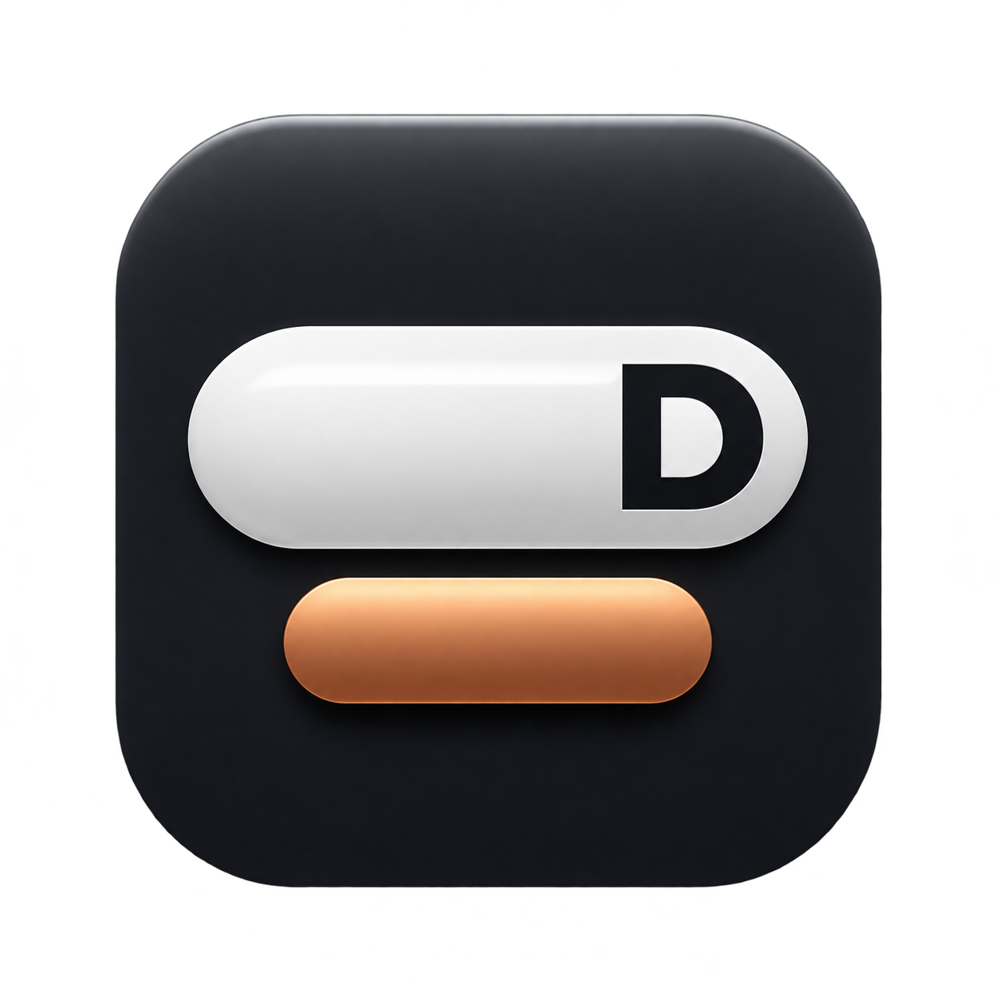

# DeckIsland · A Dynamic Island for Windows

<em>AI quotas, music, system readings, device batteries and notifications at the top of the screen. Collapsed until you need it.</em>

<br />

<a href="https://github.com/aristache-labs/deckisland/releases/latest">Download for Windows 11</a>

<br />

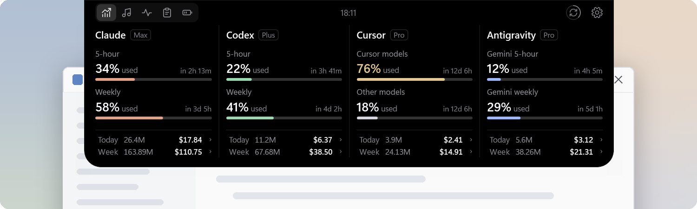

<br />


<strong>Native WPF &middot; Windows 11 &middot; read-only by design &middot; local data only &middot; English and 简体中文</strong><br>
<sub>A native Windows app built with C# and WPF for smooth animation at low resource use. What is checkable: a core test project of several thousand assertions over the pure logic (settings migration, layout and geometry, usage parsing, device protocols); a Windows UI test project that builds real controls; native media tests; and scripts that install, update and uninstall a real copy through the installer and the portable updater, in a folder whose name has a space and Chinese characters, with a unique app id so the test never touches your own installation.</sub>

<br />

[Stack](#stack) &middot; [The app](#the-app) &middot; [Local setup](#local-setup) &middot; [Install](#install) &middot; [Privacy](#privacy) &middot; [FAQ](#faq) &middot; <a href="README.zh-CN.md">简体中文</a>

<br />
</div>

---

## Overview

DeckIsland is a Dynamic Island for Windows 11. It stays collapsed at the top of the screen as a notch, a capsule or an indicator, and opens when you move the pointer over it. Open, it shows the quotas and usage of your AI coding tools, the music you are playing, system readings, the batteries of your wireless devices, the weather, a focus timer, reminders, notifications, and a clipboard history with a file transfer. Closed, it keeps the ones you choose in view and shows short readouts (volume, a lock key, a notification) in place. It reads what apps already keep on this PC, and changes nothing in them.

DeckIsland continues [BrimDeck](https://github.com/MoFeng2223/BrimDeck) by MoFeng2223 under the same Apache License 2.0.

## Table of Contents

- [DeckIsland · A Dynamic Island for Windows](#deckisland--a-dynamic-island-for-windows)
  - [Table of Contents](#table-of-contents)
  - [Overview](#overview)
  - [Stack](#stack)
  - [The app](#the-app)
    - [Collapsed styles](#collapsed-styles)
    - [Readouts and notifications](#readouts-and-notifications)
    - [AI usage](#ai-usage)
    - [Music](#music)
    - [System monitor](#system-monitor)
    - [Device batteries](#device-batteries)
    - [Clipboard and file transfer](#clipboard-and-file-transfer)
    - [Widgets, weather, focus timer and reminders](#widgets-weather-focus-timer-and-reminders)
    - [Panel themes](#panel-themes)
    - [More settings](#more-settings)
  - [Architecture overview](#architecture-overview)
  - [Prerequisites](#prerequisites)
  - [Local setup](#local-setup)
    - [1. Clone and restore](#1-clone-and-restore)
    - [2. Build](#2-build)
    - [3. Run](#3-run)
    - [4. Enhanced sensors (optional)](#4-enhanced-sensors-optional)
    - [5. Mirror Windows notifications (optional)](#5-mirror-windows-notifications-optional)
  - [Commands](#commands)
  - [Install](#install)
  - [Quick start](#quick-start)
  - [Uninstall](#uninstall)
  - [Privacy](#privacy)
  - [FAQ](#faq)
  - [Contributing](#contributing)
  - [Contributors](#contributors)
  - [License](#license)
  - [Support the project](#support-the-project)
  - [Connect](#connect)

---

## Stack

| Layer           | Technology                                                                              |
| --------------- | --------------------------------------------------------------------------------------- |
| Runtime         | [.NET 10](https://dotnet.microsoft.com/) (`net10.0-windows10.0.19041.0`)                |
| UI              | [WPF](https://learn.microsoft.com/dotnet/desktop/wpf/), code-built panels and XAML styles |
| Language        | C# (nullable enabled)                                                                   |
| Audio           | [NAudio](https://github.com/naudio/NAudio) (WASAPI) for levels, volume and the equalizer |
| System readings | `System.Management` (WMI), performance counters, ETW, optional sensor service           |
| Script editor   | [AvalonEdit](https://github.com/icsharpcode/AvalonEdit)                                 |
| Notifications   | WinRT `UserNotificationListener` (needs the sparse package, see setup)                  |
| Settings        | JSON under `%LOCALAPPDATA%\DeckIsland`, with versioned migrations                       |
| Installer       | [Inno Setup](https://jrsoftware.org/isinfo.php), plus a portable zip                    |
| Updates         | GitHub Releases, checked from inside the app                                            |
| Tests           | Console test projects: core logic, Windows UI, native media                             |
| Platform        | Windows 11 x64 (Windows 10 2004 or later with limited support)                          |

---

## The app

### Collapsed styles

DeckIsland sits at the top center of the screen and comes in three styles: Notch (default), Capsule and Indicator.

<table>
  <tr>
    <td align="center">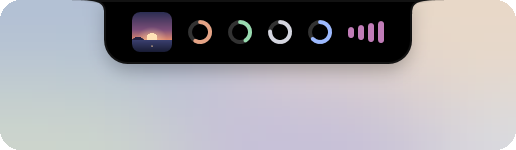<br>Notch (default)</td>
    <td align="center">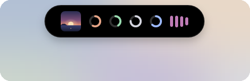<br>Capsule</td>
    <td align="center">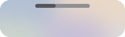<br>Indicator</td>
  </tr>
</table>

- Notch and Capsule show each tool's quota usage as rings. Choose one ring per tool (the default), or nested rings: up to three concentric rings per tool, each showing the quota you choose. The rings and the panel's bars can show what is used or what is left, and the first letter of the tool's display name can be shown inside its ring (off by default). They also preview the music that is playing with its cover, an equalizer, and the title or the current lyric line.

  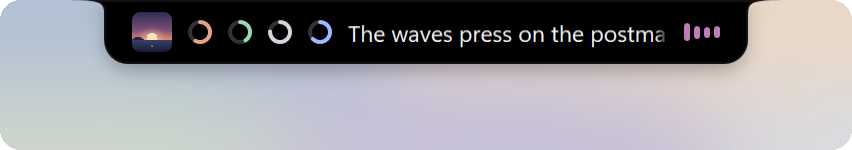

- The notch and capsule can show the time and date. The time sits on the right when shown with the quota rings or music, and is centered when shown alone; its colors can be customized. On a side edge it stands as hours over minutes, with AM or PM under them on a 12-hour clock.

  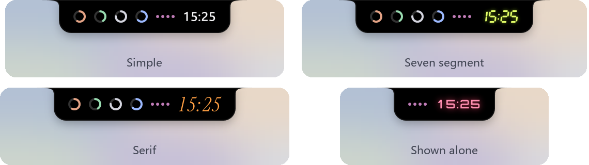

- When a tool's quota usage rises to the warning (70%) or critical (90%) level, the collapsed view shows a notice for 5 seconds. You can turn this off in settings.

  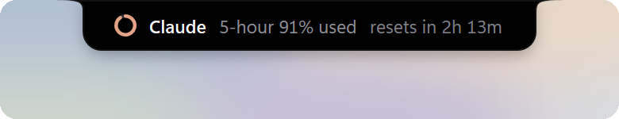

- Notch and Capsule can show system readings, device batteries, the weather, a running focus session and the number of files in the file transfer next to the quota rings and the music.

  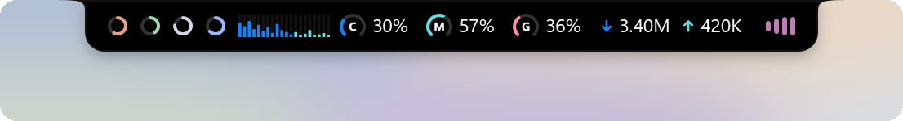

  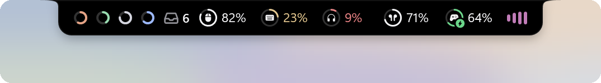

- **Full** shows everything you chose; **Minimal** shows one or two items (for example the clock and the date) and gives way to a focus session, a transfer or music while they run.
- The size and position of the Notch, Capsule and Indicator can be adjusted in settings. The Notch, Capsule and Indicator can hang from the top, bottom, left or right edge of the screen, and all three styles can sit inside the taskbar. A **Corners** slider makes every corner of the island, the open panel and the cards square or fully round.
- By default it turns into the Indicator when a window is maximized, and hides during full-screen games or video so it never opens by accident.
- It stays above other windows by default. It can instead be covered by other windows like any window, coming to the front when it expands (Settings › General › Window behavior).

### Readouts and notifications

Short readouts appear in the collapsed island itself, which takes their width for the moment and then goes back: volume and brightness (a level bar), battery (charging, unplugged, low), a Bluetooth device connecting or disconnecting, Caps, Num and Scroll Lock, and downloads in your Downloads folder with their speed. A dot on the island lights while the microphone, camera or screen capture is live, with the apps listed on hover and a list of apps to ignore.

Windows notifications show as a card (the app's icon, the title and the message) and are kept in a **Notifications** tab, stacked by app: press a stack to open it downward, press a notice to open its app. Reading Windows notifications needs a package identity, which `scripts/notifications/register.ps1` registers once (see [Local setup](#5-mirror-windows-notifications-optional)). Every readout can be switched off in Settings › Notifications and HUDs.

### AI usage

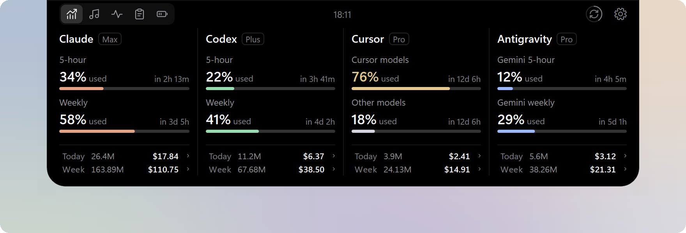

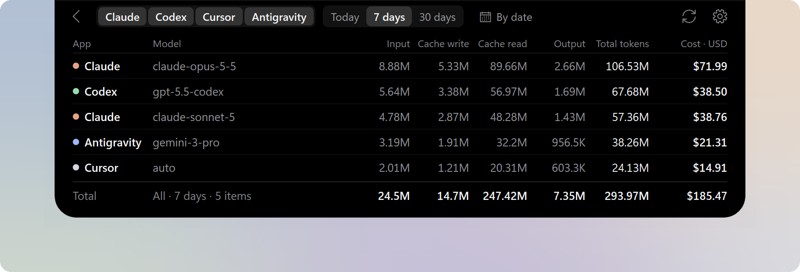

- One column per tool shows the plan, quota usage and reset countdowns, for up to 7 tools at once.
- The bottom of each column totals tokens and estimated cost for today and the last 7 days.
- Token and cost details are available for each model, filtered by tool and date range.

You can choose the quota providers and set the quota and usage source of each column separately. See [Supported tools](docs/en-US/ai-tools.md).

### Music

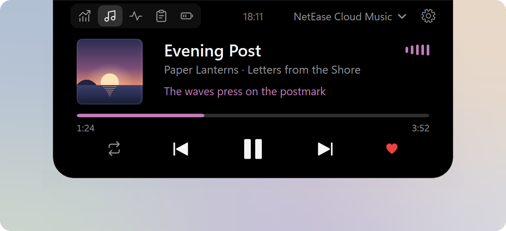

- Shows song information, synced lyrics and playback progress, with playback controls, playback mode switching and seeking in supported players.
- Works with several players at once; switch between them or pin one, and ignore apps you do not want shown.
- The equalizer can flow with the sound or show its pitch from low to high as a spectrum; its length and colors can be adjusted.
- Drag with the mouse or swipe with two fingers on the music page to change the song, switch players or adjust the volume.

Works with players that use Windows media controls, with extra support for NetEase Cloud Music, QQ Music, Apple Music and KuGou Music. See [Supported players](docs/en-US/music-players.md).

### System monitor

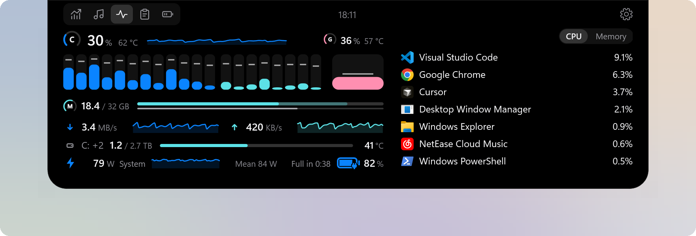

- Shows CPU, GPU and memory usage and network speed in real time, along with the usage of each core; with more than one graphics card, you choose which one shows.
- Lists the busiest apps by CPU or memory; click an app for its details.
- Shows the space in use on internal drives, the whole machine's power draw, and the battery of a laptop or tablet.
- Optionally shows CPU, GPU and solid-state drive temperatures, and the frame rate of the program in front.
- Choose which readings the expanded page shows, and in what order, under Settings › System monitor; the page lays itself out for any choice, and what is not chosen is not read.
- Colors follow the panel theme by default; several preset color schemes are offered, and you can make your own.

For where each reading comes from and its limits, see [System monitor readings](docs/en-US/system-monitor.md). PCs whose CPU temperature or power cannot be read can turn on [enhanced sensors](docs/en-US/enhanced-sensors.md).

The page is adapted from [ftop](https://github.com/Nongfsq/ftop) by Nongfsq (MIT License), a system monitor for macOS.

### Device batteries

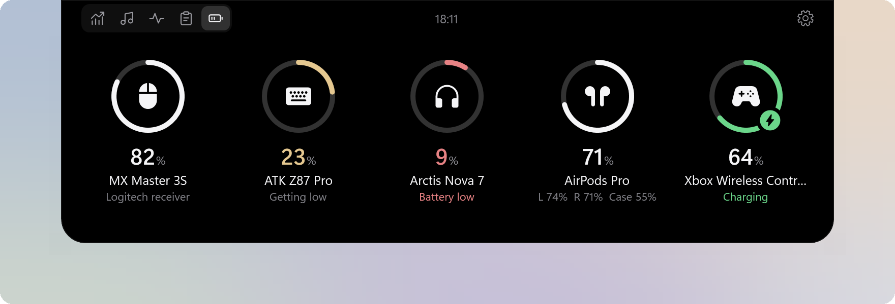

- Shows the battery of the connected wireless mice, keyboards, headsets, controllers and pens; AirPods show each bud and the case.
- A battery that is getting low takes the warning color and a low one the critical color; a charging one shows a bolt. Both thresholds can be adjusted.
- Rename devices, change their order and colors, and choose separately whether each shows on the page and when collapsed.
- Batteries are only read: nothing on the devices or in Windows is changed.

For the supported connections, brands and models, see [Supported devices](docs/en-US/devices.md).

### Clipboard and file transfer

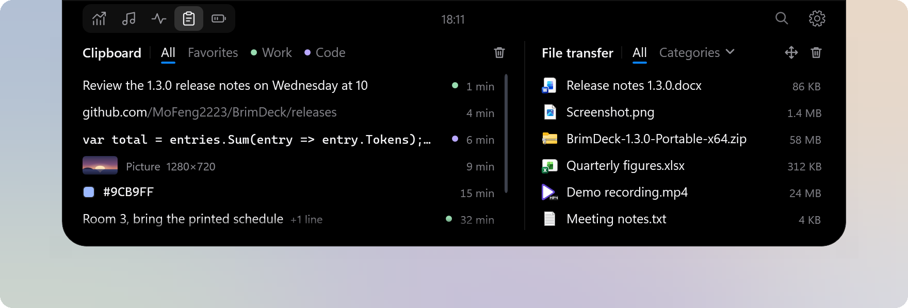

- **Clipboard**: Keeps the text and pictures you copy; click an entry to paste it into the window you are working in. Links, code and color values each show in their own style.
- The history is stored only on this PC and cleared when DeckIsland exits by default, or kept for 1 day, 7 days or 30 days; what is in Favorites or in a category set to be kept stays. You can choose apps that are not recorded.
- **File transfer**: Drag files onto the notch, the capsule or the panel to hold them, then click to paste them into the current window or drag them to where you need them. Only each file's location is kept, never a copy.
- Both columns have categories with rules for what goes in by itself, and can be searched together.

For how to use it and its settings, see [Clipboard and file transfer](docs/en-US/clipboard.md).

### Widgets, weather, focus timer and reminders

- **Widgets**: a 2×2 grid page with the cards you choose: weather, system monitoring with small graphs, a focus timer with its controls, device batteries, the quotas of every running agent (one card each, with its icon and Daily/Weekly or 5-hour figures in the Theme, Warning and Critical colors), and today's date with its week. A round button at the center opens the reminders.
- **Weather**: the current weather and the day's range, with a colourful card option; the temperature can show collapsed.
- **Focus timer**: a work and break timer with start, pause, reset and ±1 minute, shown in the panel and, while it runs, in the collapsed island.
- **Reminders**: add one in a dialog (When: 10 min, 30 min, 1 hour, this evening, tomorrow morning or a picked time; Repeat: once, every day, weekdays, every week) or by typing `20m buy milk`. At the due time the island shows a card with Snooze and Done and plays the Windows alarm; the center widget button shows the time left to the next one.

### Panel themes

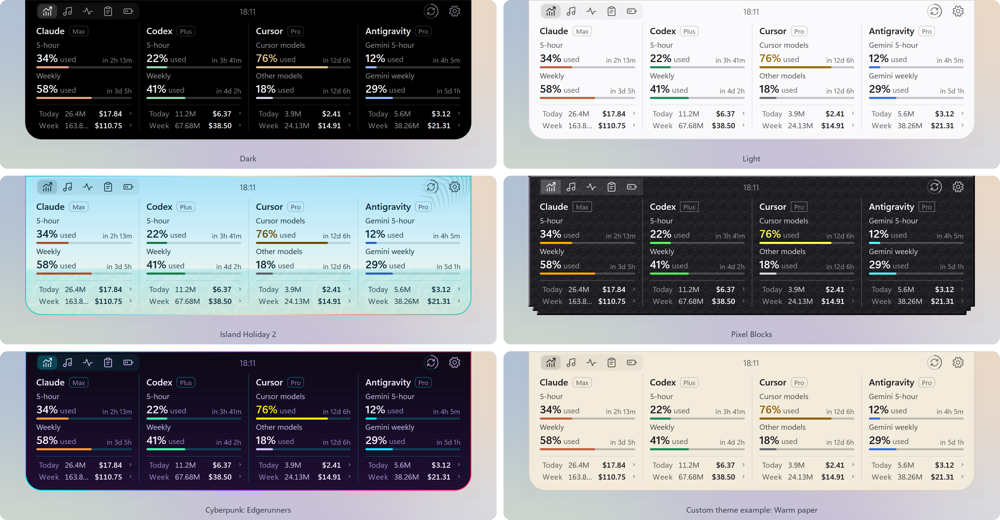

- Built-in themes include Dark, Light, One Dark Pro, GitHub Dark, GitHub Light, Dracula, Night Owl, Island Holiday, Pixel Blocks and Cyberpunk: Edgerunners; the Island Holiday themes change between a day and a night look by the local time.
- On the Panel theme page in settings, you can change the background, foreground, accent and other colors and save them as a custom theme, or write a theme file by following the [theme guide](docs/en-US/themes.md).
- The interface font can be any font installed on the PC, and the panel's background transparency can be adjusted (Settings › General › Appearance and language). Time can follow Windows or be forced to 12 or 24 hours.

### More settings

- **Shortcuts**: Global shortcuts can expand or hide the panel, open a given page, switch the collapsed style, and move or resize the panel (Settings › Shortcuts). A panel a shortcut opens takes the keyboard: Tab and the arrow keys move between its controls, Enter and Space press them, and Esc or the shortcut again closes it and hands the keyboard back to the window you were in.
- **Expand on**: Hover or click (Settings › General › Hover and animation).
- **Mouse pass-through**: Hovering no longer opens the panel and clicks go through it to the window beneath; only shortcuts open it. This suits gaming (Settings › General › Compatibility).
- **Scale**: The panel can be drawn at 100% or 150% for high-resolution displays.
- **Resource use**: Saver, Balanced and Smooth (Settings › General › Startup and resources).

---

## Architecture overview

- **Three projects** - `DeckIsland` is the WPF app (windows, panels, native readers). `DeckIsland.Core` holds everything that has no UI: settings and their migrations, collapsed geometry, page rules, usage and price parsing, the device protocols, themes, update logic. `DeckIsland.Sensors` is an optional Windows service that reads what needs elevation.
- **One island, one frame** - every collapsed style and screen edge is laid out as if it hung from the top; an edge frame turns it for the left, right and bottom, and the content is turned back upright. Readouts and notifications take the surface's width through the same route as any content that asks for another width, so they move with its usual animation.
- **Read-only** - quotas, usage, batteries, readings and notifications are read from what apps already keep or expose. Nothing in them or in Windows is changed. Sign-in tokens are used in memory only.
- **Data** - settings, themes, history and logs live in `%LOCALAPPDATA%\DeckIsland` (a former `BrimDeck` folder is copied there once). The clipboard history and the file transfer's list never leave the PC.
- **Looks** - every color is a token of the panel theme (`surface`, `accent`, `track`...); widgets, readouts and cards take theirs from it, so a custom theme restyles all of them. The Corners setting scales every radius, within what each shape allows.
- **Updates** - the app checks GitHub Releases, downloads the installer or the portable package, and replaces itself; a failed update puts the old version back.
- **Sparse package** - Windows lets only an app with a package identity read notifications. `scripts/notifications` holds a sparse manifest and a script that registers it for the folder the app runs from.

---

## Prerequisites

- **Windows 11 x64** (Windows 10 2004 or later works with limited support).
- **[.NET 10 SDK](https://dotnet.microsoft.com/download)** - builds and runs everything.
- **PowerShell 5.1 or 7** for the release and test scripts.
- Optional: the **Windows SDK** (`makeappx.exe`, `signtool.exe`) to register the notification package, and an elevated PowerShell for that step.

---

## Local setup

### 1. Clone and restore

```bash
git clone https://github.com/aristache-labs/deckisland.git
cd deckisland
dotnet restore DeckIsland.sln
```

### 2. Build

```bash
dotnet build DeckIsland.sln -c Release
```

### 3. Run

```bash
dotnet run --project src/DeckIsland/DeckIsland.csproj
```

The island appears at the top of the primary display. Settings and data go to `%LOCALAPPDATA%\DeckIsland`.

### 4. Enhanced sensors (optional)

A local build has no sensor service of its own. Publish it as one self-contained file and put it beside `DeckIsland.exe`, then turn it on under Settings › Enhanced sensors:

```bash
dotnet publish src/DeckIsland.Sensors/DeckIsland.Sensors.csproj -c Release -r win-x64 --self-contained true -p:PublishSingleFile=true -o artifacts/sensors
```

Copy `artifacts/sensors/DeckIsland.Sensors.exe` to the folder `DeckIsland.exe` runs from.

### 5. Mirror Windows notifications (optional)

Registering the sparse package gives the app an identity, so it can read notifications. It installs a self-signed certificate in the machine's Trusted People store, so read the script first, and run it from an elevated PowerShell:

```powershell
.\scripts\notifications\register.ps1 -AppFolder "C:\path\to\the\folder\with\DeckIsland.exe"
```

Restart DeckIsland afterwards. Undo it with `Get-AppxPackage DeckIsland.Notifications | Remove-AppxPackage`. Register again if the app's folder changes.

---

## Commands

| Command                                                                          | Description                                                           |
| -------------------------------------------------------------------------------- | --------------------------------------------------------------------- |
| `dotnet build DeckIsland.sln -c Release`                                         | Build every project                                                   |
| `dotnet run --project src/DeckIsland/DeckIsland.csproj`                          | Run the app                                                           |
| `dotnet run --project tests/DeckIsland.Tests/DeckIsland.Tests.csproj -c Release` | Core logic tests (settings, geometry, parsing, protocols)             |
| `dotnet run --project tests/DeckIsland.WindowsTests/DeckIsland.WindowsTests.csproj -c Release` | Windows UI tests (real controls, settings pages)        |
| `dotnet run --project tests/DeckIsland.MediaTests/DeckIsland.MediaTests.csproj -c Release` | Native media tests (player bridges)                         |
| `scripts/Publish-Release.ps1 -Version x.y.z`                                     | Build the installer and the portable zip, and the update manifest     |
| `scripts/Update-ReleaseNotes.ps1 -Version x.y.z`                                 | Replace a published release's notes without rebuilding it             |
| `scripts/Test-AppUpdate.ps1`                                                     | Install, fail an update, update, and uninstall a real test copy       |
| `scripts/Test-PortableUpdate.ps1`                                                | Update a portable copy with a file held open, then normally           |
| `scripts/Test-MigrationVersions.ps1 -TargetBranch dev`                           | Check that a settings migration step is labelled with its version     |
| `scripts/notifications/register.ps1 -AppFolder <folder>`                         | Register the sparse package that lets the app read notifications      |

> Release notes live in `releases/<version>.md`, one block per language with `<!-- lang: en-US -->` markers. The app shows the reader's language; the GitHub release shows the whole file.

---

## Install

Requires Windows 11 (x64). Windows 10 (version 2004 or later) has limited support.

1. Download one of these files from [Releases](https://github.com/aristache-labs/deckisland/releases/latest):
   - Installer: `DeckIsland-<version>-Setup.exe`. Run it and follow the steps.
   - Portable: `DeckIsland-<version>-Portable-x64.zip`. Extract it and run `DeckIsland.exe` in the `DeckIsland` folder.
2. If Windows shows "Windows protected your PC", select "More info", then "Run anyway".

Both versions update from within the app, and both keep settings and data in `%LOCALAPPDATA%\DeckIsland`.

- The app offers releases only; turn on "Receive beta updates" on the About DeckIsland page of settings to be offered betas too.
- When the portable version is in a folder that needs administrator rights to change, such as `C:\Program Files`, the update asks for administrator approval.

---

## Quick start

1. After you install and start DeckIsland, the panel appears at the top center of the primary display, showing Claude and Codex by default.
2. Move the pointer over the panel to open it; move away or press Esc to close it.
3. Use the page switch at the top of the open panel to move between AI usage, music, the system monitor, the clipboard and file transfer, device batteries, the weather, the focus timer, widgets, reminders and notifications; pages you do not need can be turned off or reordered under Settings › Expanded view.
4. Select the settings button at the top right of the open panel to add tools or change settings. You can also right-click the open panel, double-click the tray icon, or right-click the tray icon.

---

## Uninstall

- Installer: uninstall DeckIsland from Apps in Windows Settings.
- Portable: turn off starting with Windows in settings if it is on, then delete its folder.

To remove settings and data as well, also delete `%LOCALAPPDATA%\DeckIsland`. If you turned on enhanced sensors, uninstalling the installed version removes the sensor service too; with the portable version, turn it off under Settings › Enhanced sensors first. To remove the notification identity, run `Get-AppxPackage DeckIsland.Notifications | Remove-AppxPackage`.

---

## Privacy

- Reads only the sign-in state and usage records that apps already keep, and never changes, renews or ends their sign-ins.
- Sign-in tokens are used only in memory and never written to disk; API keys you enter are stored on this PC, encrypted by Windows.
- The clipboard history, the file transfer's list and the notifications tab are stored only on this PC and never uploaded.
- Notifications are read only to show them in the island; the sensor indicator reads which apps use the microphone, camera or screen capture, and nothing else about them.
- Goes online only to read quotas and usage, update model prices, fetch lyrics, covers and the weather, and check for updates. Conversations are never uploaded, and no usage data is collected.

For the files DeckIsland reads and the addresses it connects to, see [Data and privacy](docs/en-US/privacy.md).

---

## FAQ

**A tool shows "Not connected" or "Waiting for update". What should I do?**
Make sure the tool is signed in on this PC; for example, Antigravity needs its desktop app running for its quota to be read. When DeckIsland cannot read the data, it shows the actual status and never makes up numbers.

**Is the cost shown what I actually pay?**
No. Costs come from the amounts reported by each service or from public model prices, and are meant to show how much you use. Your actual subscription charges are on each provider's bill.

**Why does the system monitor show no CPU temperature or power?**
On many PCs Windows does not provide either. Turn on enhanced sensors under Settings › Enhanced sensors, or run HWiNFO or LibreHardwareMonitor alongside. See [Enhanced sensors](docs/en-US/enhanced-sensors.md).

**My mouse, keyboard or headset shows no battery. Why?**
The device has to be connected and be one of the connections or models listed in [Supported devices](docs/en-US/devices.md). For a device that is not listed, you are welcome to report its model in [Issues](https://github.com/aristache-labs/deckisland/issues).

**Windows notifications do not show in the island. Why?**
The app needs a package identity first: run `scripts/notifications/register.ps1` once for the folder it runs from, restart it, and allow notification access if Windows asks. Settings › Notifications and HUDs says which of these is missing.

**Animations or the equalizer bars never move. Why?**
DeckIsland's animations and equalizer bars need two settings turned on: DeckIsland's Settings › General › Hover and animation › Animate expanding and collapsing, and Windows Settings › Accessibility › Visual effects › Animation effects. If either is off, the expand animation, the equalizer bars and scrolling text all stop.

---

## Contributing

Contributions are welcome. Report problems, suggest features or ask for more tools, players and devices in [Issues][issues], and contribute through pull requests.

- Do not open pull requests against `main`:
  - Open new features and general fixes against the `dev` branch.
  - When a version enters testing, it gets a `release/<version>` branch (for example `release/1.3.0`). Open fixes for that version against that branch. It accepts fixes only, not new features.
- Upcoming work is listed in the [DeckIsland roadmap](https://github.com/aristache-labs/deckisland/discussions/57). Suggest features under that post, and reply there when you want to take on one of its items. Other topics are welcome in [Discussions](https://github.com/aristache-labs/deckisland/discussions).
- Run the three test projects before you open a pull request (see [Commands](#commands)). A change to the settings file format needs a migration step labelled with the version its branch builds.

## Contributors

Thanks to everyone who has contributed to DeckIsland.

<a href="https://github.com/aristache-labs/deckisland/graphs/contributors">
  
</a>

## License

DeckIsland is licensed under the [Apache License 2.0](LICENSE). Third-party licenses are listed in [ThirdPartyNotices.txt](src/DeckIsland/ThirdPartyNotices.txt).

- DeckIsland continues BrimDeck by MoFeng2223, which is licensed under the same Apache License 2.0; thanks to its author.
- The system monitor page is adapted from [ftop](https://github.com/Nongfsq/ftop) by Nongfsq, licensed under the MIT License; thanks to its author.
- Parts of the device battery protocols are ported from several open-source projects, listed in [Supported devices](docs/en-US/devices.md#acknowledgements); thanks to their authors.

## Support the project

DeckIsland is Apache 2.0 licensed and free to fork. A star on [the repository][repo] helps others find it.

## Connect

<div align="center">

**Adrian Cristache** · [aristache.dev](https://www.aristache.dev)

<a href="https://github.com/aristache-labs"></a>
<a href="https://www.aristache.dev"></a>
<a href="https://github.com/aristache-labs/deckisland/releases/latest"></a>

</div>

[repo]: https://github.com/aristache-labs/deckisland
[issues]: https://github.com/aristache-labs/deckisland/issues
[pulls]: https://github.com/aristache-labs/deckisland/pulls
[contributors]: https://github.com/aristache-labs/deckisland/graphs/contributors
[license]: https://github.com/aristache-labs/deckisland/blob/main/LICENSE
